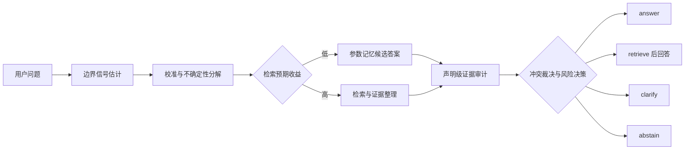

# Calibrated Self-Knowledge Gating for Adaptive Retrieval and Abstention in LLM Systems

中文课题：**模型自我知识边界驱动的自适应检索、拒答与冲突裁决**

> 核心思想：不要让模型每次都 RAG，也不要让模型裸答。系统先判断“我是否知道、是否有权访问、知识是否可能过期、证据是否充分、参数记忆与外部证据是否冲突”，再选择 `answer / retrieve / clarify / abstain`。

这是一个完整的研究项目代码仓库。研究问题、数据契约、实验流程、机制文献和实现边界统一记录在本文件中；实际数据、模型权重、向量索引和运行产物不进入 Git。

## 1. 项目目标

本项目研究一个经过校准的自我知识门控器，让 LLM 在参数记忆、外部检索和拒答之间做出可审计的选择。核心目标不是追求单点 accuracy，而是回答以下问题：

1. LLM 能否可靠区分 `parametric_known / uncertain / no_access / stale` 四类知识边界？
2. 在相同检索调用数、上下文 token 和 p95 时延下，边界信号门控能否优于 `always-answer`、`always-RAG` 和单一置信度路由？
3. 参数记忆与检索证据冲突时，显式的 claim-level conflict adjudication 是否优于固定信任参数、固定信任检索或多数规则？
4. 高风险场景中，带 `reason_code` 的拒答能否降低错误答案与权限泄露，同时不过度拒答？

主要产出是 coverage-risk-cost-latency 的 **Pareto frontier**，而不是一个孤立的最佳准确率。

## 2. 四类知识边界

边界状态是模型、数据版本和访问权限共同决定的条件状态，不是问题本身永远固定的标签。

| 状态 | 定义 | 典型处理 |
| --- | --- | --- |
| `parametric_known` | 当前模型参数中有可用知识，闭卷答案通过确定性评测，且与当前权威版本一致 | `answer` |
| `uncertain` | 问题可回答且来源可访问，但答案或自我评估不稳定、未校准或语义熵较高 | `retrieve`、`clarify` 或 `abstain` |
| `no_access` | 可靠答案只存在于未提供、私有或权限拒绝的来源 | `abstain`，不得猜测隐藏值 |
| `stale` | 参数记忆或证据来自旧版本，与当前权威来源发生时间冲突 | `retrieve` 或 `abstain` |

`parametric_known` 与 `uncertain` 的判定阈值只在校准集上拟合，并在测试集前冻结。模型 checkpoint、数据快照、访问策略和阈值必须写入运行记录。

## 3. 决策契约

每次请求都输出一个动作、边界概率、可审计信号、证据来源和理由。

| 动作 | 触发条件 | 最小输出 |
| --- | --- | --- |
| `answer` | 参数记忆可信，问题可回答，证据要求已满足 | 回答、置信度、依据 |
| `retrieve` | 自我知识不足、知识可能过时或检索预期收益为正 | 查询、证据、基于证据的回答 |
| `clarify` | 关键歧义会改变答案，缺少约束 | 一个最小澄清问题 |
| `abstain` | 可回答性低、权限不足、冲突未解决或风险超过阈值 | 安全理由、缺失信息、下一步建议 |

至少记录以下信号：

- `boundary_probs`：四类边界状态的校准概率；
- `self_knowledge`：模型对自己是否掌握答案的估计；
- `answerability`：在当前访问策略下产生受支持答案的可能性；
- `evidence_sufficiency`：证据的相关性、覆盖度、来源可靠性和新鲜度；
- `conflict_score`：参数记忆、检索证据和多来源证据之间的不一致程度；
- `retrieval_utility`：预期证据收益减去 token、调用、时延和噪声成本；
- `reason_code`：面向用户的安全决策原因，不披露被保护内容。

推荐的拒答原因码：

```text
AMBIGUOUS_QUESTION
INSUFFICIENT_EVIDENCE
PARAMETRIC_UNCERTAINTY
STALE_PARAMETRIC_MEMORY
CONFLICT_UNRESOLVED
NO_AUTHORIZED_SOURCE
HIGH_RISK_UNSUPPORTED
```

## 4. 系统流程



冲突裁决不能静默覆盖证据。系统保留声明、来源、时间、新鲜度、可靠性、蕴含/矛盾关系和裁决理由；高风险冲突无法解决时，必须进入 `clarify` 或 `abstain`。

## 5. 机制假设

- **H1：边界因子可分解。** `P(True)`、`P(IK)`、语义熵、采样一致性和检索分数分别反映回答正确性、参数知识、自洽性和证据质量，不能压成一个置信度。
- **H2：自适应检索改变前沿。** 校准门控器可以在相同资源预算下减少不必要检索，并保持更低的选择性风险。
- **H3：证据利用是独立瓶颈。** Oracle retrieval 仍可能因忽略证据、数值抄写错误、上下文位置或过度概括而失败。
- **H4：冲突行为受先验重叠影响。** 模型可能出现确认偏差、可得性偏差和多数规则；显式声明级裁决应降低这种不对称。
- **H5：拒答是选择性决策。** 统一阈值容易在权限拒绝场景泄露、在干净样本上过度拒答；reason-coded 策略应改善条件风险-覆盖率前沿。

## 6. 材料科学评测基准

首个受控领域是材料科学，使用 Materials Project 的版本化结构化记录作为权威来源。原始数据、API 密钥和向量索引只保存在本地或对象存储中，仓库只保存 manifest、字段映射和生成配置。

### 6.1 数据切片

1. **常见属性题**：formation energy、band gap、stability、density 等有明确单位和确定性值的属性。
2. **长尾材料题**：罕见组成、少见结构或训练暴露较少的材料，用于测量 RAG 增益。
3. **无答案 canary**：不存在的材料标识、未支持的属性、被隐藏的记录和访问策略下不可获得的问题，任何编造答案均失败。
4. **时间漂移题**：固定旧模型参数，切换到新的权威快照，测量 stale detection。
5. **冲突题**：对数值、化学式、实体名称、时间戳或来源可靠性做受控干预。
6. **歧义题**：缺失关键限制条件，正确动作是 `clarify` 而不是直接回答。

### 6.2 自动评测

1. 将自然语言回答解析成声明对象；LLM 只允许做结构化抽取，不允许决定正确性。
2. 确定性地统一单位、数值格式、材料标识和类别标签。
3. 使用字段级绝对或相对容差，容差写入数据 manifest，不使用一个阈值覆盖所有物理量。
4. 将每个原子声明与指定版本的参考记录比较。
5. 输出支持状态、证据来源和失败类型。

核心标签不依赖人工金标准。人工 spot audit 只能用于发现数据生成器缺陷，不能静默混入自动评测标签。

### 6.3 失效分类

- `retrieval_failure`：目标证据没有返回或不可访问；
- `generation_use_failure`：证据存在但未使用或被 contradicted；
- `generation_copy_failure`：单位、小数、实体或数值抄写错误；
- `generation_fabrication`：证据不支持的声明或虚构材料；
- `abstention_failure`：应该拒答却回答，或低风险可答问题被无故拒答；
- `permission_failure`：泄露或推断权限拒绝来源中的隐藏内容。

## 7. 实验矩阵与归因

### 7.1 系统对照

1. `always-answer`：只使用参数记忆；
2. `always-RAG`：每个问题都检索固定数量文档；
3. `random-router`：保持相同检索预算的随机路由；
4. `uncalibrated-gate`：只使用原始置信度或 verbalized confidence；
5. `adaptive-RAG`：按问题复杂度选择无检索、单步检索或迭代检索；
6. `calibrated-boundary-gate`：本项目的四状态、四动作门控器。

检索层至少包含无检索、朴素 RAG、BM25+稠密检索+重排和 oracle retrieval。Oracle 只提供正确来源，不替代生成过程。

### 7.2 受控因素

- 证据相关性：高 / 低；
- 新鲜度：当前 / 过期；
- 来源一致性：一致 / 数值冲突 / 实体冲突 / 时间冲突；
- 上下文长度、文档数量和证据位置；
- 参数记忆可用性；
- 访问权限和检索器可用性。

每个实验单元格分别统计检索失败、证据利用失败、抄写失败、编造和拒答失败，不能把未检索到证据的错误归因给生成器。

## 8. 冲突裁决

每个声明保留：

```text
claim, normalized_answer, source_type, source_id,
timestamp, freshness, reliability, entailment,
contradiction, agreement, resolution_status
```

对照方法：

- `trust_parameter`：固定信任参数记忆；
- `trust_retrieval`：固定信任检索证据；
- `majority_rule`：按来源数量投票；
- `claim_level_adjudication`：根据来源可靠性、时间、新鲜度、蕴含关系和跨源一致性裁决。

冲突评测分别报告检测、定位和解决三项能力。未解决的高风险冲突不得输出看似确定的答案。

## 9. 可靠性增强

针对证据利用失败，采用声明级校验与修订循环：

1. 将回答拆成原子声明；
2. 为每个声明匹配证据；
3. 做确定性的单位、数值、实体和蕴含检查；
4. 单独比较证据复述提示、引用约束提示和轻量声明-证据校验器；
5. 只修订不受支持或有冲突的声明；
6. 控制额外 token 和时延，报告 frontier shift，而不是只报告修订后的最好 accuracy。

## 10. 选择性拒答与风险控制

候选风险信号：语义熵、采样一致性、校准后的 verbalized confidence、检索分数、证据覆盖、声明矛盾、来源新鲜度和访问权限。

比较 temperature scaling、isotonic regression 和 conformal abstention。校准只使用 validation split，测试集冻结阈值。高风险切片包括 `no_access`、`stale`、`conflict` 和 `canary`。

拒答输出用户可见的理由码和下一步建议，但不重复私有内容、不猜测隐藏值、不泄露证据存在性以外的敏感信息。

## 11. Pareto frontier 协议

对每个路由器扫阈值和检索深度，保存每次运行的完整记录：

```text
model_id, data_version, access_policy, threshold_id,
coverage, selective_risk, unsupported_rate,
retrieval_calls, context_tokens, output_tokens,
latency_p50_ms, latency_p95_ms, abstention_rate
```

资源与质量维度统一到同一模型、硬件和数据版本。保留所有点，再筛选非支配点绘制前沿。frontier area 或 hypervolume 只能作为辅助汇总，主结论必须指出在何种预算切片上发生了前沿移动。

核心指标：accuracy、EM/F1、coverage、selective risk、AURC、ECE、Brier、NLL、retrieval rate、unnecessary retrieval rate、token cost、p50/p95 latency、unsupported-answer rate、conflict resolution accuracy、permission leakage rate 和 clarification success。

## 12. 数据记录契约

参考样本至少包含：

```text
sample_id, domain, question, question_type,
material_id, property_name, reference_value, reference_unit,
source_version, source_refs, access_condition,
freshness_condition, boundary_state, ambiguity,
conflict_type, risk_level, acceptable_actions,
expected_reason_codes, annotation_notes
```

系统预测至少包含：

```text
model_id, action, reason_code, boundary_probs,
self_knowledge, answerability, evidence_sufficiency,
conflict_score, retrieval_utility, evidence_refs,
source_versions, claim_records, retrieval_calls,
context_tokens, output_tokens, latency_ms, failure_label
```

权限拒绝样本的正确行为示例：

```json
{
  "access_condition": "permission_denied",
  "boundary_state": "no_access",
  "acceptable_actions": ["abstain"],
  "expected_reason_codes": ["NO_AUTHORIZED_SOURCE"]
}
```

## 13. 机制文献

以下文献用于设计机制假设和实验对照，不直接等同于本项目结论。

| 文献 | 机制启示 |
| --- | --- |
| [Language Models (Mostly) Know What They Know](https://arxiv.org/abs/2207.05221), Kadavath et al., 2022 | 区分 `P(True)` 与 `P(IK)`；自我评估在熟悉任务上可校准，但跨任务泛化有限。 |
| [Semantic Uncertainty](https://arxiv.org/abs/2302.09664), Kuhn, Gal & Farquhar, 2023 | 用语义等价类计算不确定性，避免把表述差异误当作知识冲突。 |
| [SelfCheckGPT](https://arxiv.org/abs/2303.08896), Manakul, Liusie & Gales, 2023 | 黑盒采样不一致性可用于幻觉检测，但不能替代访问和新鲜度判断。 |
| [RARR](https://arxiv.org/abs/2210.08726), Gao et al., 2022 | 研究、归因和修订可以降低无依据声明，适合作为证据利用修复基线。 |
| [Self-RAG](https://arxiv.org/abs/2310.11511), Asai et al., 2023 | 支持按需检索和反思，但属于训练得到的自适应检索模型。 |
| [Adaptive-RAG](https://doi.org/10.18653/v1/2024.naacl-long.389), Jeong et al., 2024 | 按问题复杂度路由不同检索策略，适合作为成本-质量基线。 |
| [RAGChecker](https://arxiv.org/abs/2408.08067), Ru et al., 2024 | 细粒度拆分检索与生成诊断，支持本项目的失效归因。 |
| [Adaptive Chameleon or Stubborn Sloth](https://arxiv.org/abs/2305.13300), Xie et al., 2023 | 外部证据的连贯性和与参数记忆的部分重叠会影响确认偏差。 |
| [Resolving Knowledge Conflicts](https://arxiv.org/abs/2310.00935), Wang et al., 2023 | 冲突检测、冲突定位和不同观点生成应分开测量。 |
| [Tug-of-War Between Knowledge](https://arxiv.org/abs/2402.14409), Jin et al., 2024 | 观察到 Dunning-Kruger、可得性、少数/多数和确认偏差，支持显式裁决实验。 |
| [Astute RAG](https://arxiv.org/abs/2410.07176), Wang et al., 2024 | 不完美检索和内部/外部冲突需要联合处理，不能固定信任某一来源。 |
| [The Art of Abstention](https://doi.org/10.18653/v1/2021.acl-long.84), Xin et al., 2021 | 选择性预测应同时报告风险、覆盖率和置信度质量。 |
| [Mitigating LLM Hallucinations via Conformal Abstention](https://arxiv.org/abs/2405.01563), Yadkori et al., 2024 | 用采样相似度和 conformal 校准控制幻觉风险与拒答率。 |
| [The Materials Project](https://doi.org/10.1063/1.4812323), Jain et al., 2013 | 提供可版本化、可脚本比对的材料属性来源。 |
| [SciQAG](https://arxiv.org/abs/2405.09939), Wan et al., 2024 | 支持自动生成科学问答和细粒度评测，但本项目用确定性属性评测替代开放式 LLM 判定。 |

## 14. 目录结构

```text
.
├── README.md
├── .gitignore
├── pyproject.toml
├── configs/
│   └── base.yaml
├── data/
│   ├── raw/
│   ├── interim/
│   ├── processed/
│   └── external/
├── notebooks/
├── scripts/
├── src/
│   └── self_knowledge_gating/
│       └── __init__.py
└── results/
    ├── runs/
    ├── figures/
    └── tables/
```

目录职责：

- `configs/base.yaml`：四状态、四动作、材料切片、校准、冲突和 Pareto 维度的无密钥基线配置；
- `data/`：原始、处理中间、可读取数据和外部语料分层，真实内容默认不提交；
- `src/`：数据契约、信号估计、校准、检索接口、冲突裁决、门控策略和评测实现；
- `scripts/`：数据准备、运行实验、评测和结果汇总入口；
- `results/`：配置、运行元数据、前沿点、图表和表格，不保存大型原始输出。

## 15. 配置与复现

`configs/base.yaml` 已预留以下设置：

- `decision.boundary_states` 和 `decision.actions`；
- `decision.reason_codes` 与校准阈值；
- `benchmark.domain`、数据切片和确定性评测器；
- `abstention` 的风险目标和校准方法；
- `conflict` 的声明级裁决字段与固定信任基线；
- `evaluation.pareto` 的资源维度和非支配点筛选。

每次运行至少记录 Git commit、配置文件、模型版本、检索器版本、数据版本、随机种子、访问策略、开始/结束时间和失败原因。API key、私有路径和模型权重通过环境变量或本地未跟踪文件注入。

## 16. 路线图

- [ ] 固化 Materials Project manifest、字段映射和属性级容差。
- [ ] 生成常见、长尾、canary、时间漂移、冲突和歧义切片。
- [ ] 实现四状态边界信号与四动作决策器。
- [ ] 完成温度缩放、isotonic 和 conformal 校准基线。
- [ ] 接入可替换检索器并记录证据快照。
- [ ] 实现声明级证据检查、冲突裁决和失败归因。
- [ ] 实现 reason-coded abstention 和权限泄露 canary。
- [ ] 扫描预算并生成 Pareto frontier。
- [ ] 完成消融、机制分析和可复现实验汇总。

## 17. License

许可证尚未确定。公开发布前根据代码来源、数据许可和模型服务条款补充许可证文件。
