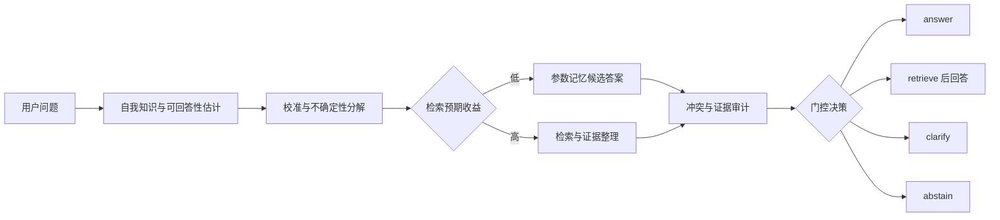

# Calibrated Self-Knowledge Gating for Adaptive Retrieval and Abstention in LLM Systems

中文课题：**模型自我知识边界驱动的自适应检索、拒答与冲突裁决**

> 核心一句话：不要让模型每次都 RAG，也不要让模型裸答；先估计“我知不知道、知不知道能不能知道、证据够不够、检索与参数记忆是否冲突”，再决定 `answer / retrieve / clarify / abstain`。

## 1. 研究问题

现有 LLM 系统通常在两个极端之间选择：始终依赖参数记忆，或对每个问题都执行检索增强生成（RAG）。前者容易产生幻觉和过时回答，后者带来不必要的检索成本、延迟和噪声证据。本项目研究一个经过校准的自我知识门控器（self-knowledge gate），让系统根据问题的可回答性、模型的知识边界、证据充分性和参数记忆与外部证据的冲突程度，选择合适的行动。

本项目要回答的主问题是：

> 在准确性、选择性风险、检索成本和拒答质量之间，能否通过校准的自我知识信号，学习一个比 always-answer 和 always-RAG 更可靠的决策策略？

## 2. 决策契约

系统的每次决策都必须输出一个动作、可审计的信号和理由。动作定义如下：

| 动作 | 触发条件（初始设计） | 最小输出 |
| --- | --- | --- |
| `answer` | 参数记忆可信，问题可回答，且证据要求已满足 | 回答、置信度、依据 |
| `retrieve` | 自我知识不足或知识可能过时，检索预期收益为正 | 检索查询、证据、基于证据的回答 |
| `clarify` | 问题存在关键歧义，缺少约束会改变答案 | 一个最小澄清问题 |
| `abstain` | 可回答性低、冲突无法裁决或风险超过阈值 | 拒答理由、缺失信息、下一步建议 |

门控器至少记录以下信号：

- `self_knowledge`：模型对自己是否掌握答案的估计，并在验证集上校准。
- `answerability`：问题是否存在可验证、可交付的答案；它不等同于模型的主观置信度。
- `evidence_sufficiency`：当前证据是否支持回答，包含相关性、覆盖度和来源可靠性。
- `conflict_score`：参数记忆、检索证据和多来源证据之间的不一致程度。
- `retrieval_utility`：检索带来的预期收益减去成本、延迟和噪声风险。

## 3. 研究流程



冲突裁决不允许只根据一个分数静默覆盖证据。系统需要保留冲突来源、时间、新鲜度、来源可靠性和裁决理由；无法在阈值内解决时，进入 `clarify` 或 `abstain`。

## 4. 研究假设

- **H1：自适应检索**。经过校准的门控器可以减少不必要的检索，同时保持或提升回答准确率，相比 always-RAG 具有更低的检索率和成本。
- **H2：选择性可靠性**。允许 `abstain` 后，系统的 coverage-risk 曲线和 AURC 优于 always-answer；在相同 coverage 下，选择性风险更低。
- **H3：冲突裁决**。显式建模参数记忆与检索证据的冲突，可以减少知识过时、来源不一致和证据不足导致的错误回答。
- **H4：澄清收益**。在问题歧义可被一个最小问题消除时，`clarify` 比直接回答或直接拒答具有更高的后续任务成功率。

## 5. 评测设计

评测集按决策类型分层，而不是只按题目主题分层：

1. 模型已知且证据稳定的问题。
2. 模型可能不知道或长尾的问题。
3. 会随时间变化、需要外部证据的问题。
4. 存在多个合理解释的歧义问题。
5. 参数记忆与检索证据受控冲突的问题。
6. 证据相关但不足以支持结论的问题。

对照系统至少包括 `always-answer`、`always-RAG`、随机门控、未校准自我报告和只使用单一置信度的门控器。实验应报告总体结果、分层结果和消融结果，避免将某个数据集上的平均准确率当作门控能力的充分证据。

核心指标：

- 回答质量：accuracy、EM/F1 或任务适用的评分。
- 选择性预测：coverage、selective risk、AURC、abstention precision/recall。
- 校准质量：ECE、Brier score、NLL、可靠性图。
- 检索效率：retrieval rate、unnecessary retrieval rate、token/latency cost。
- 决策质量：clarification success、conflict resolution accuracy、unsupported answer rate。

阈值只能使用验证集确定；测试集只用于最终报告。所有结果需要保存配置、模型版本、检索器版本、随机种子和证据快照索引。

## 6. 目录结构

```text
.
├── README.md
├── .gitignore
├── pyproject.toml
├── configs/
│   ├── README.md
│   └── base.yaml
├── data/
│   ├── README.md
│   ├── raw/                 # 原始数据，不提交真实内容
│   ├── interim/             # 清洗和中间产物
│   ├── processed/           # 可供实验读取的版本化索引/清单
│   └── external/            # 外部语料或基准数据
├── docs/
│   ├── research_plan.md     # 问题定义、假设、实验矩阵和里程碑
│   └── annotation_schema.md # 数据标注与 JSONL 契约
├── notebooks/               # 探索性分析，不作为生产入口
├── scripts/                 # 数据准备、运行实验和汇总结果的入口说明
├── src/
│   └── self_knowledge_gating/
│       ├── __init__.py
│       └── README.md        # 预定模块边界
└── results/
    ├── README.md
    ├── runs/                # 本地运行产物
    ├── figures/             # 图表
    └── tables/              # 表格
```

## 7. 当前状态与使用方式

当前提交是研究代码骨架，重点是固定概念、数据边界和实验协议；具体模型、检索器和数据集尚未绑定。安装入口已经由 `pyproject.toml` 预留，后续实现阶段可在不改变目录契约的情况下添加依赖和命令行入口。

建议的工作顺序：

1. 根据 `docs/annotation_schema.md` 建立小规模、可审计的开发集。
2. 实现四动作决策器和信号记录，不先追求复杂检索器。
3. 在验证集上校准阈值，固定配置后再运行测试集。
4. 将每次运行的配置、决策日志和汇总指标写入 `results/runs/`，只提交可复现的轻量元数据。

## 8. 数据与隐私约束

真实数据、模型权重、API 密钥、向量索引和大体积运行产物默认不进入 Git。数据目录中的 `.gitkeep` 只用于保留目录；数据来源、许可、版本、清洗脚本和哈希应记录在对应清单中。任何需要外部服务的配置都通过环境变量注入，不把密钥写入 `configs/`。

## 9. 路线图

- [ ] 固化数据标注协议和开发集。
- [ ] 实现自我知识、可回答性和证据充分性信号。
- [ ] 实现温度缩放或等价的校准基线。
- [ ] 接入一个可替换的检索器并记录证据快照。
- [ ] 实现参数记忆与证据冲突裁决器。
- [ ] 完成四动作门控、消融和选择性风险评测。
- [ ] 发布可复现实验配置和结果汇总。

## 10. License

许可证尚未确定。公开发布前请根据代码来源、数据许可和模型服务条款补充许可证文件。
